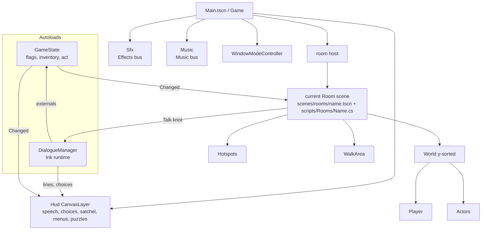
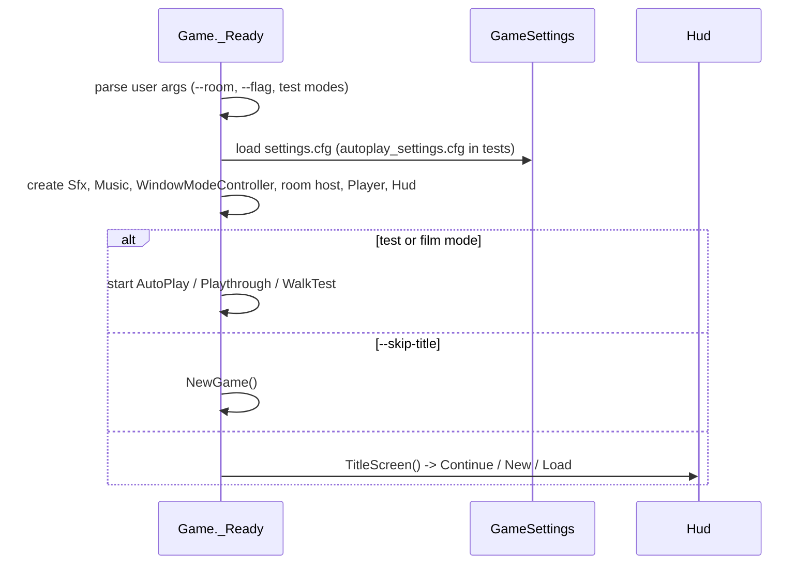
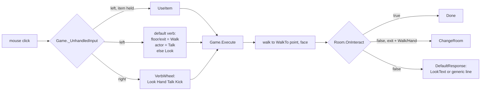
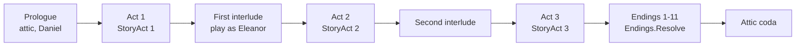

# Architecture

## Shape of the program

`scenes/Main.tscn` contains `Main` running `Game.cs`. Services and UI are built in C#; room scenes are loaded on demand.

| Layer | Folder | Godot? | Role |
|---|---|---|---|
| Framework | `scripts/Core/` | mostly | `Game`, `Room`, `Hotspot`, `Actor`, `Player`, state, dialogue, saves, audio |
| Rules and data | `scripts/Core/` (`Items`, `Notes`, `MicahKit`, `Recipes`, `PuzzleRules`, `SwipeGesture`, `Endings`, `SaveData`, `*Synth`, `InkScan`) | **no** | Pure C#, linked into the xunit project and unit-tested |
| Story glue | `scripts/Story/` | yes | Item verbs, combinations and puzzles valid in any room; interludes |
| Rooms | `scripts/Rooms/` + `scenes/rooms/` | yes | One script and one scene per location (38 rooms) |
| Dialogue | `dialogue/repentance.ink` | - | All conversations, compiled by GodotInk on import |
| UI | `scripts/UI/` | yes | `Hud` (partials), `VerbWheel`, `GameMenu`, `NotepadView`, `CloseUp`, puzzle screens |
| Debug | `scripts/Debug/` | yes | Automated runs: `Harness`, `AutoPlay`, `Playthrough` (and film mode), `WalkTest` |
| Assets | `assets/art/`, `assets/fonts/`, `assets/audio/{piano,sax,bass}/` | - | Generated PNGs (by `tools/`), pixel fonts, recorded instrument notes |
| Tools | `tools/art/`, `tools/run/`, `tools/music/` | - | Python art generators; normal-game, test and film launchers; C# music tool (piano recordings, WAV renders) |
| Tests | `tests/` | - | xunit (`Repentance.Tests`), Python art and launcher tests |

## Boot

`tools/run/game.sh` / `tools\run\game.ps1` clean, build and import before this normal boot path, without test or
film arguments. Shared launcher helpers handle discovery and logs; see [Getting started](getting-started.md#first-run).

`NewGame()` resets state, Ink and playtime, seeds debug kits outside the attic, applies `--flag`, then calls
`ChangeRoom(StartRoom, StartEntry)` (defaults: `attic`, `start`; a debug room without `start` uses its first entry).
Code: `scripts/Core/Game/Game.Startup.cs`.

## The interaction loop

A room returns `true` from `OnInteract` when handled. `Game.Run` marks scripted actions busy and reports exceptions;
see the [scripting API](core-framework.md#scripting-api-use-inside-gamerun).

Inventory actions follow the same pattern with their own chains:

- item on item: `Story.CombineScripts.TryCombine` -> `Recipes.Evaluate` / `Apply` (then `Room.OnCombined` with the result) ->
  `Room.OnCombine` -> refusal.
- verb on item: notepad -> `Room.OnItemVerb` -> `Story.ItemScripts.TryHandle` -> generic.

## State and data flow

- **`GameState`** (autoload): flags, ordered inventory, act (1-3). Effective changes emit `Changed`; rooms refresh
  visibility and the HUD redraws inventory.
- **Ink** keeps its own variables and visit counts, but reads and writes game state only through externals
  (`has_flag`, `set_flag`, `has_item`, `give_item`, `take_item`, `knows_note`, `cash_amount`). Flags are the
  shared vocabulary between C# and Ink.
- **Saves** snapshot `GameState`, Ink's JSON state, the room, position and facing. Loading never replays
  `OnEnter`.
- **Settings** live apart from saves in `settings.cfg`.

## Room change

`Game.ChangeRoom(scene, entry)`: validate scene and marker -> fade out (0.35 s) -> unload the old room -> instance
`res://scenes/rooms/<scene>.tscn` -> reparent the persistent `Player` into its `World` -> pick the player sheet,
ambience and music -> place the player at `Entries/<entry>` facing `metadata/facing` -> fade in ->
`await room.OnEnter(entry)` -> queue autosave for the next idle frame. Code: `scripts/Core/Game/Game.Rooms.cs`.

## Story structure in code

Acts change in `Attic` (reading the journal) and `Story.Interlude`. Each new act resets the satchel to
`MicahKit.ActKeep`. Details in [Story and dialogue](story-and-dialogue.md).

## Partial classes

Add code to the partial for its concern:

| Class | Files |
|---|---|
| `Game` | `Game.cs` (fields, `_Process`) + `Game/Game.{Startup,Input,Commands,Items,Scripting,Rooms,Persistence,Pause}.cs` |
| `Hud` | `Hud.cs` + `Hud/Hud.{Dialogue,Inventory,Screens,Images}.cs` |
| `AutoPlay` | `AutoPlay.cs` + `AutoPlay/AutoPlay.{Act1,Act2,Act3,Endings,Dialogue,Interface,Pause,Presentation,Puzzles,Inheritance}.cs` |
| `Playthrough` | `Playthrough.cs` + `Playthrough/Playthrough.{Act1,Act2,Act3,Endings}.cs` |
| `Items` | `Items.cs` + `Items/Items.{Micah,Act1,Act2,Act3}.cs` |
| `SoundSynth`, `MusicSynth` | `SoundSynth.Effects.cs`; `MusicSynth.{Instruments,Scores}.cs` |

## Third-party code

- `addons/GodotInk/` - Ink compiler (C# import plugin) and runtime. `addons/GodotInk/GodotInk.props` is also
  imported by the test project so tests compile the same story.
- Fonts in `assets/fonts/`; licences in [CREDITS.md](../CREDITS.md).
