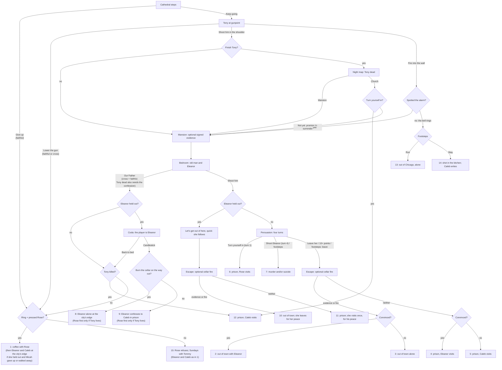

# Story overview

Spoiler recap. [Walkthrough](../Walkthrough.md) is the authoritative story spec.

Play the story yourself with `tools/run/game.sh` / `tools\run\game.ps1`. Watch it with `tools/run/film.sh`
(default 1x), or choose `--speed 4` / `-s 4`; ending/chapter selection is described in [Testing](testing.md).

## The game, beat by beat

0. **Prologue, the attic (today)**: Daniel calls his son Leo, who doesn't come. Lift the dust sheet, knock
   over the boxes, then search them again: the MISC box holds a locked tool tin. The suitcase's small key opens that tin,
   not the trunk; its crowbar opens the steamer trunk. Inside is Micah's journal.
   Right-click it in the satchel and choose the hand to read it. This part doubles as the tutorial.
1. **Office**: Teddy briefs you, hands over Eleanor's photograph and leaves the first day's $22 on the desk. The
   revolver hangs in its holster on the coat rack and the lockpicks are in the filing cabinet. Micah won't leave
   without all three.
2. **Aurelian Hotel lobby**: the concierge sees nothing. A dollar loosens the bellboy's memory; another buys the
   staff elevator up to Eleanor's floor. Steer the cage through the maze of service shafts from the loading bay
   to the fifth-floor linen room next to 507 (rooms count up west to east), then dispatch it.
   Micah collects the brass box in room 507 before departing for the Blue Lantern.
3. **Linen room**: the corridor door to 507 is night-bolted from the far side and has no keyhole. Take a wire
   hanger from the rack and the pliers from the housekeeping cart, combine them into a wire hook (the pliers
   go back on the cart) and use the hook on the door to lift the bolt through the transom.
   **Room 507**: the room has been turned upside down. Pick the locked desk drawer for Eleanor's riddle,
   open the closet and decode it (apostles, the days in the desert, the week of creation: 12, 40, 7; "rightly ...
   left ... rightly" for the directions). Each right stop drops a tumbler, and the dial opens at right 12 / left 40
   / right 7. Micah
   finds it strange that a dame like her would bring Christ into it.
   Then take the brass box.
   Open it in the satchel with the hand: a
   calling card carrying her perfume, a matchbook from the Blue Lantern, a vial of laundry bluing and a
   Japanese water flower with a riddle: "Give me a drink and I'll tell you the word."
4. **Rizzo's Flowers, State Street**: the Blue Lantern hides behind a florist's cold room. The chalkboard asks
   for blue carnations only. Take a white carnation from the bucket, combine it with Eleanor's
   bluing and show the blue carnation at the cold-room grille to be let in. Drop the water flower in the
   carnations' bucket and it opens with the club's password, MOONSHINE, written on its petals (optional).
   **Blue Lantern speakeasy**: walking past Sal or talking to him starts the door talk. Say "Moonshine." if the water flower gave you
   the password and Sal lets you in for free; otherwise bribe him with $10, leaving $10 after all the bribes
   (mock him or refuse and
   you're thrown straight out back). Ask Tony the bartender what he's got and Micah can order his bathtub gin for $1
   and knock it back at the bar. Tony won't talk; once you've asked about Eleanor, when you're done he decides he
   doesn't like you, and nods to Sal.
5. **The alley behind the club**: one flickering street lamp. Micah on his knees after the beating; Tony tells
   him Eleanor is "hot stuff" and that he sent her to the nuns. Micah stands, then the player clicks the street exit;
   "The next evening", the convent.
6. **The convent** (exterior → corridor → cell → corridor), the evening after the beating, in the rain: Micah remarks on the architecture outside;
   click the convent door to enter. Sister Agatha questions Micah, warns him off "that Jezebel", then lets
   him see Eleanor's cell. The nightstand drawer holds a comb and a little mirror with a strange symbol on
   the    back, hidden under wax. Borrow the cloth from the bed, warm the mirror at the lamp, and combine
   mirror and cloth to reveal the symbol. Micah means to return the cloth but can't bring himself to: he keeps
   Eleanor's perfumed cloth until the end (ending 1 throws it away). He won't leave before that discovery.
   The cell door returns to the corridor. Talk to the sister for her farewell, or click the front door and
   she calls Micah back for the same exchange before letting him leave.
7. **Outside the convent**: no Eleanor, only the rain. Micah lights a cigarette in the middle of the road, hands cupped
   against the wind, and drags on it as he thinks: a dead end. He turns
   down three leads (the mob would kill him; he won't face Harrington until the job's done; the cops are bought).
   The fourth, the office, is cut short when he spots a motel sign down the road, shown in a close-up.
8. **Behind the motel, the lobby, the fire escape**: in the rain, Micah goes in by the side door. The nervous desk
   clerk, plainly in the mob's pocket though he never says so, won't let him upstairs, but lets him walk off with
   the umbrella from the stand. In the alley, push the crate under the fire escape and hook the drop ladder down
   with the umbrella (Puzzle 19). On the first-floor landing Eleanor, in black, opens with a question about his
   climb, and Act One cuts to black on it.
9. **End of Act One**: back in the attic at night, lamp on. Daniel is called down to dinner.
10. **Act Two, the next day**: Daniel picks the journal up again (hand on it in the satchel). Over black,
    "Chicago, 1927.", then "First Interlude" under it.
    **First Interlude** (the player is Eleanor, in Micah's journal voice: what she told him that night at the motel):
    pack the brass box, lock the safe and drawer and telephone Rizzo's Flowers in room 507, then Sal takes her down
    the service stairs. At the Blue Lantern Tony sends her to the convent. In the corridor Sister Agatha calls her
    "a Jezebel from that hideous Club"; that night Agatha comes to her cell to hear her confession, with motives she won't admit: Eleanor
    can seduce her for the convent's protection (Agatha turns back at the last moment, cursing her as a demon) or tell
    her the truth (saved; she stammers out only the Club and its painted stage before Agatha cuts her off, reaches for her, is stopped, and puts her out at first light). From the motel window, four days on, she watches Micah reach
    the convent, smoke in the road, come asking at the desk and climb the fire escape; she steps out to wait for him.
    Over black, the journal goes back to Micah, already on the landing in front of her.
11. **The fire escape, again**: Eleanor repeats her opening question. After it, a framed close-up shows Micah on the
    left and Eleanor on the right, each speaking beneath their own portrait. It disappears before the compensation
    choice; the rest takes place on the landing. "Then stay. Right here." Micah walks slowly to her and, as her line
    about the rain ends, kisses her. His narration admits the pull he can't resist and the guilt over Rose; then a
    slow fade to black, "Later that night", and a slow fade into her room.
12. **Motel, that night**: in her room, Micah gets dressed, Eleanor lies under the sheet. A mistake; they won't meet
    again, and Micah drops the case. He asks where she'll go: away, she has friends and money enough. He suspects it
    isn't true, but he's too ashamed to ask more, and she sees it; he leaves. "Days later" on black.
13. **Office, the motel again, then cathedral steps**: Micah drinks whiskey from a cup, admits his shame at walking
    out and his lust for her, and chooses to take his wedding ring or leave it behind. The original choice is saved;
    a left-behind ring can be collected later. He goes back to the motel: the drop ladder is pulled up again, and he
    won't climb it ("Better brace the joe at the desk"). The clerk says she left, then won't say more until Micah
    hauls him across the counter by his tie ("Nice tie, pal. Your wife's present?"): two men took her, the night
    Micah left. He walks to the cathedral, unable to think of anything but Eleanor.
14. **Inside the cathedral**: Micah tells his brother Caleb he's too far off to be saved. Caleb calls it the
   Devil's work. Micah admits he can't get past "hallowed be Thy name" in the Our Father; "Then start there. He
   remembers the rest." "I'll think about that." Coming was a mistake, and Micah walks out.
15. **Map of Chicago**: "I have to find her again." Pick the library, the cathedral or the office.
16. **Library, by day**: ask the librarian about the knot (shown full screen). He wants to know where
   the mirror came from; Micah won't say, so neither will he. Consult the desk catalogue: match the
   Celtic triquetra and select Bell's *Rites of the Old Isles*, C-17. The restricted shelves are locked.
   Micah grabs the librarian by the collar (or, if the player prefers, pulls the revolver on him) to obtain
   that book. He hands over a book of Celtic rituals, and the library is off limits from then on.
17. **Office**: read the book's concealed-ink instructions, warm the hotel card on the radiator and combine
   it with the mirror. Order the reflected fragments lily, leaf, feather to obtain the Club address.
   The steps can be discovered in a different order; all three clues remain available.

From here the story follows Walkthrough.md:

18. **Club** (hall): the Master of Ceremonies knows exactly why Micah is asking: Eleanor is "already with us,
   safe, and where she belongs". A brute shows Micah out.
19. **The street**: Micah on the pavement, asking himself why he left his wife and son. Go find his wife, or push
   forward.
20. **Rose's house** (optional): the rain stops at her street (Micah remarks on it). Ring the bell. Push for
   forgiveness up to five times, or leave; push at least
   three times and Rose calls him back: "Wait!", then a framed close-up of her at the door beside Micah, "Don't get into trouble again." and Micah's silent "...".
21. **Cathedral**: press Caleb about the club. He admits the Club traffics girls for its Thursday spectacles, and
    that he and the sisters hide the ones who escape while he keeps quiet so the Club leaves the convent alone.
    Micah calls him a hypocrite who could have gone to the press. Caleb points Micah to the convent and begs him to give up.
    On repeat visits Caleb offers a cross if Micah originally left the ring; if he originally took it, offers begin
    only in Act Three. Refusing allows another offer on the next eligible visit; accepting gives the pendant once.
22. **Convent**: Sister Agatha knows nothing until Micah draws the revolver on her. Eleanor is a performer;
   then Agatha confesses that she went to Eleanor's cell and failed her (still calling her a Jezebel only if Eleanor
   seduced her). Try Harrington senior. Micah decides to look him up at the Tribune.
    **Tribune newspaper morgue** (new map marker): take the torn top of a clipping from the H drawer, the
    bottom from the copy spike and the paste pot from the layout desk; paste one half, combine it with the other half,
    and Micah pins the mended clipping on the Loop wall map at once. The Harrington Building replaces the Tribune on the map.
23. **Behind the Harrington Building, at night**: set the trash can alight with the lighter so the watchman
   runs inside to phone the fire department. Take the packing wedge, stack the crates and use the wedge
   on the jammed ladder catch before climbing in.
24. **Harrington's office**: pick the locked right drawer for an invitation to the club, for Thursday night; behind the closet's false
   back are a white Bauta mask and a cloak. Look at the portrait for a close-up of the heraldry at its foot
   (raven and star, lion and sun, stag and moon), then follow the invitation's raven/lion/stag procession; set the
   false-back lock to STAR / SUN / MOON. The lock's clue box only says "Three dials. Three symbols."
25. **Club vestibule, masked**: the street door is closed to Micah tonight; the map leads to the front. The plaque
   wants the summons sealed by the first of the procession. Soften the cloakroom's sealing wax with the
   lighter (kept), press it on the invitation, then take the raven signet from the first cloak and seal it.
   Post the sealed invitation in the door slot.
   **Club, masked**: through the hall and the lounge, full of masked men and women (white Bauta masks and carved
   bear, raven and hare faces), to the stage, where Eleanor stands among three masked men: stag, boar and wolf. A framed close-up
   of Eleanor's face, masked men behind her, pops up over the stage until the fade.
   **End of Act Two**: back in the attic, dinner again.
26. **Act Three, the bedroom**: Daniel reads in bed while his wife sleeps; the next pages aren't in Micah's hand.
    **Second Interlude** (Eleanor): the Order's men take her from the motel. In the Club's dressing room, in a short
    pink gown, she puts her face on alone; then the old man comes in by the stage door and offers gin and powder "as
    always": take them, or refuse (saved; the screen goes black,
    "Noooo!"). Then Micah's journal goes on at the Club stage.
27. **Club**: the close-up of Eleanor again; "Are you satisfied, now, mister Jones?" It closes before the choice: draw the revolver, don't, or start the Our Father (Harrington cuts him off at "hallowed be Thy name": "How childish..."); either way Bruno knocks Micah out.
28. **Outside the cathedral**: a framed close-up of Micah, flat on his back under his hat, stays up while he admits it's Eleanor
    he wants, not Rose; it closes as he gets up. Give up (only if he carries the ring or pressed Rose; ending 1 or 15), or keep going:
29. **The office**: lamp off, whiskey on the desk, Micah stares out of the window and works out who knows where the Club keeps its girls: Tony, at the Blue Lantern.
    After standing he can collect the ring. Leaving offers Caleb or the Blue Lantern. Caleb's counsel and his offer of
    the cross happen once; accepted or refused, Micah goes on from the church straight to the Blue Lantern's alley.
30. **The alley**: break the street lamp, kick the trash cans in the dark to lure Sal out, knock him down with
   the revolver, then knock on the back door. With Tony at gunpoint, shoot him in the shoulder, or (only if Micah carries the ring
   **or** pressed Rose **or** carries Caleb's cross) walk away (ending 1 or 15). Tony sends him to old Harrington's house. First, back at the office in a storm blackout,
   the narrating voice follows his descent while lightning shows a demon shadow in the window; he leaves the bottle,
   takes the hat from the desk and goes.
31. **The Harrington mansion**: the key on the lintel would ring an alarm bell wired to the kitchen door. Look at
   the door to spot it, take the key and push the coal bin under the bell. In the close-up, plan hold hammer,
   tie hammer, release hand; cutting the wire would release the spring. Then open the door. Micah leaves his tie
   on the bell and goes on with his collar open.
32. **Kitchen, cellar and study**: the baize door to the house is bolted from the other side. Go down the cellar
   door: in the dark, take the storm lantern from its hook and the kerosene can from the crates, fill the
   lantern, light it with the lighter (kept), use the lit lantern on the dark stair, then climb the
   bootleggers' stair to the study's bar panel.
   Walking back through the baize door unbolts it. Optionally take the right drawer's account register and the left drawer's auditor's
   index. At the study desk, combine them and fit all five index holes on the account dots so BANK/JUDGE/CAPTAIN read as the note (flipped, turned 180, offset 6,9)
   to locate and take the signed payoff sheets, which also record the Club's payments for the girls. The register alone is not evidence. Entering the bedroom
   ends this opportunity; skipping remains possible and preserves the prison endings.
33. **The bedroom**: old Harrington with Eleanor. Shoot him, or (only if Micah carries Caleb's cross **and** either the ring
   or pressed Rose at least three times) choose "Our Father...": Micah says the prayer,
   a verse at a time, backing to the door while the old man talks into every pause; its last lines play over black (ending 1 or 15, or 12 if Tony was killed). Then talk Eleanor into leaving: four turns of four lines, each line
   typed and weighted, and 10 points out of 16 convince her (see [Eleanor's persuasion](eleanor-persuasion.md)). On the first turn he can
   leave her and turn himself in (ending 6); from the third he can leave her; on the fourth he can shoot her, then
   himself (ending 7). After four failed turns, footsteps: shoot himself (ending 7), shoot her and himself, or leave.
   If Eleanor told Agatha the truth and refused the old man: after the Our Father the player is Eleanor in the sheet, with the
   old man's back turned. Return to bed (ending 1 or 15, or 12 if Tony was killed), or take the candlestick off the nightstand and strike him, then
   leave by the kitchen door, optionally burning the house from the cellar first (Micah's lantern, then the barrel).
   If Micah shoots instead, she only says, worn out, "Let's get out of here, quick." and follows him: no persuasion.
34. **The escape**: optionally go back down to the wine cellar (Eleanor, if she came, waits in the kitchen), open the
   whiskey barrel, take the lit lantern off its nail and use it on the whiskey; the house burns behind them.
35. **Endings**: 1 coffee with Rose (only with the ring and having pressed her; otherwise 15); 2 out of town with Eleanor (convinced, and signed evidence or fire); 3 out of town
   alone (not convinced, signed evidence or fire); 4 prison, Eleanor visits (convinced, neither signed evidence nor fire);
   5 prison, Caleb visits; 6 prison, Rose visits (turned himself in) and the journal ends "I returned to the faith...";
   7 murder and/or suicide in the bedroom, the last entry written by Caleb; 8 coffee with Rose (unless Tony is dead),
   then Eleanor alone at the city's edge (she struck the old man and burned the house); 9 coffee with Rose (unless Tony
   is dead), then Eleanor in a jumpsuit confessing to Caleb, who absolves her (she struck him and didn't burn it);
   10 out of town, where Eleanor (worn out, she followed without persuasion) leaves Micah by the car to look for her
   peace (signed evidence or fire); 11 prison, where she visits once to wish him his peace (neither); 12 prison, Caleb
   visits (Micah killed Tony and turned himself in); 13 out of Chicago alone, after the alarm; 14 shot in the kitchen,
   the last pages written by Caleb; 15 Sunday visits: Rose refuses the coffee, but lets Micah take Tommy to Mass
   on Sundays. Every last entry says who wrote Eleanor's pages. Each ends Act Three; the next
   morning (no caption after ending 7, or after ending 14 unless Eleanor's escape with Caleb follows) Daniel keeps the journal for Leo if Micah returned to Rose or to the
   faith (endings 1, 6, 12 and 15), or in endings 8-11, saying "Maybe Leo would like to read it some day." After endings 7
   and 14 he respects Caleb's last pages and puts it back. Otherwise, he puts it back in the trunk. *The End.*

## Branches and endings

The story branches on a handful of decisions, all but two of them in Act Three. Eleanor's two refusals are made in
the interludes; their combined effect on ending selection begins once Micah reaches the old man's bedroom. Gates
(`Endings.cs`):

- **Pressed Rose**: he kept asking her for forgiveness on her doorstep (`rose_wait`).
- **Faithful**: he carries the wedding ring (`faith_ring`) or pressed Rose. Visits to Caleb open no gate by themselves.
- **Pendant**: he carries Caleb's cross (`cross`).
- **Rose forgives**: he carries the ring *and* pressed Rose (`rose_forgives`, set with the gates before each
  peaceful choice); otherwise every peaceful ending is 15 instead of 1.
- **Held out**: Eleanor told Agatha the truth instead of seducing her (First Interlude, `eleanor_refused_abbess`) *and* the old
  man's gin and powder (Second Interlude, `eleanor_refused_drugs`). One refusal alone does not unlock Eleanor's alternative bedroom branches.

How each decision is made:

- **Give up** (cathedral steps, after Bruno knocks Micah out): only if he is faithful (`can_give_up`); sets
  `gave_up_steps`.
- **Lower the gun** (Tony): if he is faithful or carries the cross (`can_walk_away`); sets `walked_away`.
- **Kill Tony** (the dialogue choice "Finish him" after the shoulder, else Micah leaves him and walks out): Tony
  knows who shot him, and he's the mob. A second
  bullet sets `killed_tony` and opens a night map with only the Blue Lantern, the church and the mansion. At the
  church Micah confesses to Caleb: he turns himself in (`surrendered_tony`, ending 12) or promises to after Eleanor
  (`confessed_tony`; if he never took the cross, Caleb offers it then). Straight to the mansion, the Our Father is gone. Left alive, Tony's revenge follows Micah into
  the epilogues: out of town, or "Tony sends his regards" in the prison yard.
- **Fire into the wall** (Tony, instead of the shoulder): `warned_tony`. Tony, unhurt, gives the house and the kitchen
  key but not the alarm (the shoulder shot gets that out of him too), and no blood means no revenge. At the mansion a
  look at the wire or bell spots the alarm, and the night goes on as usual; looking at the door or lintel and taking
  the key do not reveal it. Opening the keyed door without inspecting the alarm
  rings the bell, and feet come down the back stairs: **Run** (`alarm_ran`, ending 13: out of Chicago, the journal ends
  in Omaha with the revolver on the washstand) or **Stay** (`alarm_stayed`, ending 14: two Club men at the cook's
  table shoot him down; Caleb finishes the journal). If Eleanor held out, either is followed by her escape with Caleb
  at the city's edge, a week later (`caleb_escape`), in lines that know Micah ran or died.
- **Our Father** (bedroom): the cross and faith, and the confession if Tony is dead (`can_spare`); sets
  `spared_oldman` (ending 12 instead of 1 or 15 after killing Tony). If Eleanor held
  out, she plays the coda (`eleanor_coda`): the old man stands between her and the door, and she can't walk past
  him. She goes back to bed (ending 1 or 15, or 12 if Tony was killed), or takes the candlestick and strikes him (`eleanor_struck`), then leaves
  through the study, down to the kitchen and out of the back door. To burn the house she goes down to the cellar
  on the way (from the kitchen, or by the panel behind the study bar) and lights the Club's rye with Micah's lantern
  (`eleanor_burned`).
- **Shoot him**: if Eleanor held out, she is too worn out to argue: "Let's get out of here, quick." (`eleanor_weary`).
  No persuasion: she follows him to the kitchen in silence, and the escape decides between endings 10 and 11.
  On the road to ending 10 she has changed into the white dress and pearls from the duffle she'd packed for running,
  left on the back seat of the Club's car at the gate.
  Otherwise the persuasion: four turns, each with a possessive, a rational, a positive and a clumsy line worth 4, 2,
  1 and 0 points. Having given in at least once in the interludes, Eleanor answers the possessive, old-man voice best;
  10 points or more after four turns convince her (`eleanor_convinced`). One clumsy line can be overcome, two can't
  ([Eleanor's persuasion](eleanor-persuasion.md)). Turning himself in is offered on the first turn only (`repented`),
  leaving her from the third, shooting her on the fourth (`shot_eleanor`). After four turns without her, footsteps
  on the landing: shoot himself (`shot_himself`), shoot her and himself, or leave.
- **Eleanor's escape outfits**: once out of the sheet she wears what she packed in her duffle. Held out
  (`Endings.EleanorFreeOutfit`, endings 8, 10, 11, and endings 1 and 15 with Caleb): a white dress with her pearls. Gave in (endings 2, 4): a black
  skirt suit cut above the knee, no pearls. In prison (ending 9) she wears the inmate grey.
- **The escape**: the signed payoff sheets from the study (`took_documents`) or the cellar fire (`mansion_exploded`)
  give Micah something to bargain with and keep him out of prison.

`Endings.Resolve` takes the first match, so a give-up or walk-away wins over everything that could follow it:

| Ending | Condition (in priority order) | Scene |
|---|---|---|
| 14 / 13 | After the warning shot, the alarm rang; 14 if Micah went in | Shot in the kitchen, Caleb writes the last pages (14), or out of Chicago alone, a suicide (13); if Eleanor held out, then Eleanor and Caleb at the city's edge |
| 8 / 9 | Eleanor struck the old man; 8 if she burned the cellar | Eleanor alone (8) or in prison with Caleb (9); preceded by Micah's coffee with Rose only if Tony lives |
| 10 / 11 | Eleanor followed, worn out, after the shot; 10 with evidence or fire | Out of town, she leaves him by the car (10), or prison, she visits once (11) |
| 12 | Killed Tony and turned himself in, from the church or after the Our Father | Prison, Caleb visits |
| 1 / 15 | Gave up, walked away from Tony, or spared the old man (including Eleanor's return to bed); 1 if Rose forgives (ring and pressed Rose) | Coffee with Rose (1), or Rose refuses it and gives him Sundays with Tommy (15); after a give-up or walk-away, if Eleanor held out, then Eleanor and Caleb at the city's edge |
| 6 | Turned himself in | Prison, Rose visits |
| 7 | Shot Eleanor or himself | The bedroom; Caleb writes the last entry |
| 2 / 3 | Evidence or fire; 2 if Eleanor was convinced | Out of town, with her (2) or alone (3) |
| 4 / 5 | Neither; 4 if Eleanor was convinced | Prison, Eleanor (4) or Caleb (5) visits |

The interludes play in every run: the First between Acts One and Two (Room 507, the Blue Lantern, the convent, the
motel window), the Second at the start of Act Three (the motel, the Club's dressing room). Eleanor plays again only in
the bedroom coda (back to bed is ending 1 or 15, or 12 if Tony was killed; striking him is 8 or 9), in the epilogue of
ending 8, and, if she held out, after Rose's door when he gave up on the steps or walked away from Tony (still
ending 1 or 15: Caleb has got her out of the city, `caleb_escape`), or after the alarm (endings 13 and 14, the same
scene told after Micah ran or died). Daniel keeps the journal for Leo after endings
1, 6, 8, 9, 10, 11, 12 and 15.

### Weather

It rains on every 1927 exterior and behind every window, building from a steady rain in Act One to a downpour in
Act Three (`RainWeather`). The present day (attic, bedroom) and the library's sunny midday are dry, and so are the
saving moments: Rose's street (always), the convent cell once Eleanor refuses Agatha, the prison when Micah turned
himself in (6) or Eleanor confesses (9), and the city's edge where Eleanor walks free (8). Rooms opt out with
`Room.RainStopped`; `RainTests` lists every dry room with its reason.

## Story notes

The core plot and the five original endings are unchanged; endings 6 and 7 branch from the bedroom. The seventeen puzzles include five collect-and-combine locations and the motel fire escape; Eleanor has two more, one in each interlude. Sal receives a cash bribe Micah can afford.
The Club blames Micah for Eleanor's capture; at his Act Three desk he wonders whether somebody followed him
or he let something slip, without establishing either as fact.
The Club runs a trafficking ring that supplies fresh girls for its Thursday spectacles. Caleb and the convent hide
the girls who escape; Caleb keeps silent so the Club leaves the convent alone (Tony's "Nobody from that Club goes
near those nuns"). Harrington's unmasking and Tony at gunpoint touch on the girls, and Caleb's later visits return to
his silence. The traffic ends only where somebody exposes it: Micah's signed papers in endings 1, 6, 10 and 15 (Caleb
carries them to the Tribune, they come out at Micah's trial, or Eleanor asks him to give them to the papers),
Eleanor's testimony at her trial in ending 9, the old man's Thursday book she mails to the Tribune in ending 8,
and Micah's papers handed in with his confession to the grand jury in ending 12.
Endings 2 and 3 keep the papers as Micah's private insurance. While still supine outside the cathedral,
he admits that his pursuit is driven by lust for Eleanor, in conflict with returning to Rose and Tommy.
Caleb's leads refer to the established convent. Rose's doorstep reply remains "Forgiving's the easy part, Micah.
Forgetting is what you keep asking for."; her callback is concern, not forgiveness earned by repeatedly asking.
Micah throws Eleanor's perfumed cloth in the street before ringing, then offers coffee with "Nothing you owe me.";
the journal has them say their promises again a year later, and Daniel sees their photograph from that day (a sepia print on a
cream card).
His office reminder preserves the last opportunity to recover the wedding ring and visit Caleb.

If Eleanor refuses to follow and Micah burns the mansion, her fate remains unknown during escape.
The alone outskirts scene then begins **the next morning**: a newspaper lists Eleanor among the dead,
and Micah admits "I told myself I was saving her. I left her there and lit the fuse."
The fuse is figurative; the fire is the cellar's whiskey and the lantern. "They know who died. They don't know what I did."
replaces the previous claim that nobody will know what happened. Documents-only escape has no death report;
when Eleanor accompanies him, the scene remains that night and she survives. The existing ending outcomes remain unchanged.

Micah carries **$22** at the start of the case, enough for two $1 bellboy payments and the $10 Sal bribe: Teddy's
advance for the first day, his $20 daily fee plus $2 for expenses. This is a fictional cash
holding, not a documented average PI income. Historical purchasing-power context comes from the
[NBER/BLS manufacturing weekly-earnings series](https://fred.stlouisfed.org/series/M08261USM052NNBR):
October 1927 weekly earnings were $24.37. The $22 reserve is about 90% of that benchmark, making the $10 door
bribe a substantial payment (about 41% of the weekly benchmark),
not an ordinary tip. Bribes deduct only their respective amounts; inventory inspection shows the remaining cash.
Tony's bathtub gin costs $1: $9 left after the bribe, or $19 if Sal let him in on the password.

Exact Scripture excerpts use **Douay-Rheims (Challoner)**, appropriate to the Catholic characters:

| Dialogue | Reference |
|---|---|
| Sister Agatha's quiz | [Micheas 6:8](https://drbo.org/chapter/38006.htm) |

Caleb's counsel retains its original wording rather than added exact quotations. His prodigal-son account paraphrases
[Luke 15:17-20](https://drbo.org/chapter/49015.htm); it is not marked as a direct quotation. Ring and cross remain
reminders, not a bargain with God. Antagonists' threats and the tragic endings are not theological verdicts.

**Scope and length:** Repentance is a compact, single-case adventure: eight puzzles in Act One and six in Act Two,
then an alley encounter, an alarm puzzle, the wine-cellar lantern and optional evidence in Act Three. Its mostly linear investigation is
closer in scope to [The Blackwell Legacy](https://store.steampowered.com/app/80330/) than
[Kathy Rain (2016)](https://store.steampowered.com/app/370910/), whose published scope includes 40+ environments
and 4,000+ dialogue lines. [Technobabylon](https://store.steampowered.com/app/307580/) and
[Unavowed](https://store.steampowered.com/app/336140/) provide broader multi-protagonist/companion-based comparisons.
These compare scope, not completion time. Reading/skipping dialogue, solving puzzles
without known answers, optional visits and replaying endings substantially change duration. Autoplay is accelerated
and includes seeded regressions; its wall-clock duration must not be advertised as adventure length.

## Scripture

Biblical grounding added to existing conversations. Lines are paraphrases or thematic applications; links are to
the public-domain KJV. Writing rules: [Story and dialogue](story-and-dialogue.md#voice-and-scripture). Catholic and
Protestant readings of these lines and of the endings: [Theology](theology.md).

| Existing conversation and placement | Biblical grounding | Implemented addition |
|---|---|---|
| `caleb_act2`: after Caleb calls despair the Devil's oldest trick, before Micah's "I'll think about that" | [Mark 1:15](https://www.biblegateway.com/passage/?search=Mark%201%3A15&version=KJV); [Acts 3:19](https://www.biblegateway.com/passage/?search=Acts%203%3A19&version=KJV); [Ephesians 2:8-9](https://www.biblegateway.com/passage/?search=Ephesians%202%3A8-9&version=KJV): repentance, belief and salvation by grace, not earned wages | **Caleb:** "Turn back to God and believe, Micah. Salvation isn't wages for being good; it's grace." |
| `caleb_club`: after "You know that isn't true" | [Ezekiel 18:21-23](https://www.biblegateway.com/passage/?search=Ezekiel%2018%3A21-23&version=KJV); [1 John 1:9](https://www.biblegateway.com/passage/?search=1%20John%201%3A9&version=KJV): whoever turns from his sins is forgiven | **Caleb:** "Repentance isn't for saints at the end of their lives, Micah. It's for anyone, any day they still draw breath." / "If a man truly repents, the Lord forgives him. Every time." |
| `caleb_club`: answers Micah's "I'm too far gone" | [Proverbs 16:18](https://www.biblegateway.com/passage/?search=Proverbs%2016%3A18&version=KJV); [Romans 5:20](https://www.biblegateway.com/passage/?search=Romans%205%3A20&version=KJV): pride, and grace greater than sin; a thematic application | **Caleb:** rebukes despair as pride: arrogant and self-serving, "another way of putting yourself first" |
| `caleb_club`: closes the conversation | [Luke 15:17-24](https://www.biblegateway.com/passage/?search=Luke%2015%3A17-24&version=KJV): the prodigal returns and his father runs to welcome him | **Caleb:** "The prodigal thought he was past it too. Then he turned for home, and his father ran to meet him." |
| `caleb_warn`: directly answers Micah's "I asked nicely first" | [Luke 3:8](https://www.biblegateway.com/passage/?search=Luke%203%3A8&version=KJV): conduct worthy of repentance, applied to Micah's violence | **Caleb:** "Repentance means more than asking nicely. Put the gun away." |
| `caleb_last`: between "I never could" and Caleb's promise to pray | [Psalm 51:17](https://www.biblegateway.com/passage/?search=Psalm%2051%3A17&version=KJV): God does not despise a broken and contrite heart | **Caleb:** "God doesn't turn away a contrite heart, Micah. You don't have to be whole to turn to Him." |
| `rose_coffee`: after "Nothing. Not tonight", before the coffee invitation | [Acts 26:20](https://www.biblegateway.com/passage/?search=Acts%2026%3A20&version=KJV): deeds fitting repentance; a thematic application, not an explicit Scripture reference in the dialogue | **Micah:** "I'm not asking you to believe I've changed. I'd like to start showing you." |

Luke 15 has the father see the son from afar and run to him; it does not say he waited continuously.
